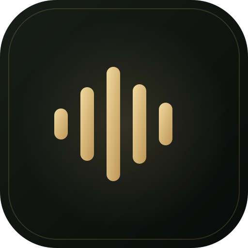

# Surmio — Music, in your rhythm 🎵

Surmio is a premium, high-fidelity web music streaming player and Progressive Web App (PWA) built for seamless music discovery, curated listening, and offline playback.



---

## ✨ Features

- **True Background & Lockscreen Playback**:
  - 100% native HTML5 audio stream architecture.
  - Keeps playing continuously when minimized, switching tabs, or when your phone screen is locked.
  - OS-level media integration via the **MediaSession API** (lockscreen widget, notification controls, wireless earbuds, and Bluetooth car controls).
  - Background queue auto-advance from song to song without interruption.

- **CineVault Now Playing Studio**:
  - Immersive full-screen player with dynamic ambient glow backdrops.
  - Smooth scrub bar with live buffering indicators and millisecond precision.
  - Synchronized lyrics drawer with line-by-line karaoke tracking.
  - 10-band sound Equalizer, Bass Boost dial, and Spatial Audio FX.
  - Aligned playback queue management (reorder songs, shuffle upcoming, clear queue).

- **Real Audio Downloads**:
  - Direct audio stream extraction with real-time saving to disk for offline listening.
  - Verified audio checking, download progress states, and offline library registration.

- **Smart Music Catalog & Infinite Discovery**:
  - Curated genres: *Bollywood, Devotional / Bhakti, Punjabi, Haryanvi, Lo-Fi, English Pop, Classical, and more*.
  - Real-time live music search and intelligent autocomplete recommendations.
  - Continuous discovery feed with seamless infinite scrolling.

- **Progressive Web App (PWA)**:
  - Installable on Android, iOS, Windows, and macOS as a standalone native app ("Add to Home Screen").
  - Fast offline shell caching powered by a dedicated Service Worker.

---

## 🚀 Quick Start

### 1. Prerequisites
- **Node.js** (v18 or higher recommended)
- **npm**

### 2. Installation
```bash
git clone https://github.com/aditys4444/Surmio-Music-app.git
cd Surmio-Music-app
npm install
```

### 3. Run the App
```bash
npm start
# or: node server.js
```

Open your browser at `http://localhost:3000`.

---

## 🛠️ Tech Stack

- **Frontend**: Vanilla JavaScript (ES6+), HTML5 Audio, Web Audio API, Service Workers, MediaSession API, CSS3 Glassmorphism & Custom Properties.
- **Backend**: Node.js, Express.js.
- **Audio Extraction & Scraper**: `@distube/ytdl-core`, Cheerio, Node streams.

---

## 📄 License
ISC

